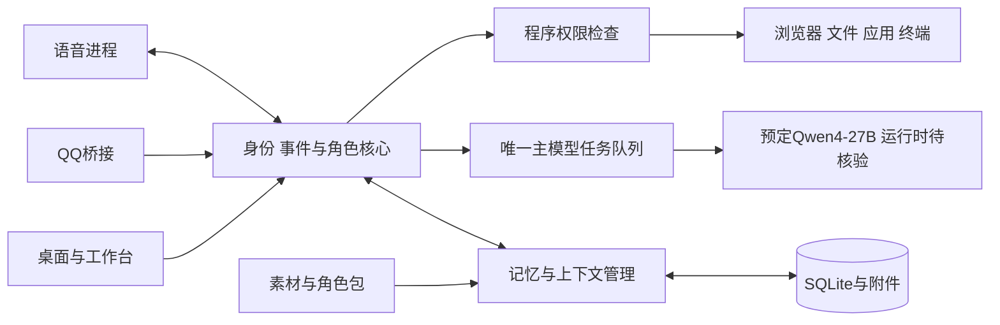

**守岸人本地数字生命总体方案 v1.6**

日期：2026-11-17。状态：M01A及M05A首轮技术原型已协调验收；用户偏好R1，但电音、断句和节奏仍未达目标，当前派发M05A2。GitHub origin已连接、未推送。M02A/B/C及原声审核保持既有结论。M00暂缓，本轮未重新核对发布状态。接口契约v0.4，无新增API语义。

本方案面向个人Windows电脑起步，逐步形成可维护的exe产品。资源预算、性能门槛和训练超参数仍是初始设计。已完成硬件检测、资料调研、首批媒体采集与本地资源只读盘点；未下载主模型、解析游戏包、训练或接入QQ。

**已经确定的项目边界。**

| 决策 | 当前基线 |
|---|---|
| 角色身份 | AI为守岸人；使用电脑的用户及开发者为她认知中的唯一漂泊者；其他用户和群成员为漂泊者的朋友伙伴 |
| 协作分工 | 协调助手负责架构、方案、契约、拆分与评估；各模块由用户交给其他AI实现 |
| 唯一主模型 | 预定Qwen4-27B，待官方发布、规格/许可/运行时核验及本机验收；不同时部署另一套主脑 |
| 本地执行 | 保持本地推理；原候选llama.cpp CUDA和混合推理方式待新模型支持核验，不提前锁定GGUF或NVFP4 |
| 训练 | 约100GB显存服务器可用；语言侧LoRA为初步路线，新基座的训练支持与容量发布后重新确认 |
| 记忆 | 原始经历保留，送给模型的工作上下文有界；自动压缩默认不删除原始经历 |
| 多入口 | 一个角色核心，桌面、QQ与语音都是入口；人格共享，私人记忆和群上下文分作用域 |
| 联网 | 核心推理和存储本地；QQ、资料检索和用户明确发起的下载需要联网；不默认上传私聊或切云端模型 |
| 技术结构 | 模块化单体后端，加独立模型、语音和平台进程；初期不建分布式集群 |
| 产品化 | 程序、模型、角色资产和私人数据独立管理；代码可进GitHub，私人资料默认不进仓库 |

**预定等待Qwen4-27B，素材工作先行。**

用户决定等待新一代模型，因此不继续执行旧Qwen3.8部署。官方已发布Qwen4-Max并说明较小规模开放权重后续推出，但这不能确定27B的具体日期、规格或许可证。[阿里云官方发布稿](https://www.alibabacloud.com/en/press-room/alibaba-unveils-qwen4-max?_p_lc=1)

上轮核对用户提供的[IteraCompute/Qwen4-27B-NVFP4](https://huggingface.co/IteraCompute/Qwen4-27B-NVFP4)时，revision为48c1adea25618d1b8d3cf9e401121e50509efd8d，只有README与.gitattributes。该快照是独立社区准备仓库记录，不能作为最新发布状态；本轮未重新查询。NVFP4也不能直接当作GGUF。

恢复M00前核验：官方模型ID/revision、实际权重与配置、图文及工具能力、许可证、tokenizer与模板、可用量化与运行时、视觉组件、16GB显存/32GB内存下的部署方式，以及服务器训练支持。届时由协调助手更新M00、模型清单与相关契约后再派发；不承诺几天内一定发布，也不在当前聊天自动设定持续监控。

M01A通过独立41项测试与真实loopback接口复核；M05A独立worker已交付16段WAV并技术通过，下一项[M05A2](../tasks/M05A2-R1声质与韵律改进.md)不依赖主模型。核心健康不代表主脑/语音服务就绪，speech仍明确503。M00通过后M01B整合真实推理与业务基础。

**以下Qwen3.8选型与快照为v1.0历史参考，不是当前执行目标。**

选择标准是中文交流与角色可训练性、图像理解、工具能力、16GB显存加32GB内存下的本地部署，以及可维护性。这里的“最好用”是满足这些约束的当前工程选择；尚无本机角色测试，不能声称已经证明它在所有模型中最优。

| v1.0检查的方案 | 当时可核实事实 | v1.0判断（已暂缓） |
|---|---|---|
| Qwen3.8-27B UD-Q4_K_M | 语言文件15.427GiB，原生图文；官方更新了多步任务与agent能力 | 当时选定；现等待新模型，不执行下载 |
| Qwen3.5-27B Q4_K_M | 语言文件约15.591GiB，部署体积相近 | 不选；没有必要同时维护相近的上一代基模 |
| Qwen3.5-35B-A3B Q4_K_M | 语言文件约20.504GiB；A3B指激活参数，全部专家权重仍要存储 | 不选；MoE可能有速度优势，但内存驻留更大，不能按3B算容量 |
| Qwen3-VL-30B-A3B-Instruct Q4_K_M | 官方GGUF语言文件约17.282GiB | 不选；也需要卸载，当前不作为第二主脑 |
| 8B–9B档候选 | 资源较宽裕 | 本轮按用户要求提高主模型档位，不继续双候选路线 |

这些文件体积来自发布方，不是运行显存。官方通用基准也不是守岸人人格表现的证据。[Qwen3.8官方模型卡](https://huggingface.co/Qwen/Qwen3.8-27B)、[3.8量化文件](https://huggingface.co/unsloth/Qwen3.8-27B-GGUF/tree/main)、[3.5-27B文件](https://huggingface.co/unsloth/Qwen3.5-27B-GGUF/tree/main)、[35B-A3B文件](https://huggingface.co/unsloth/Qwen3.5-35B-A3B-GGUF/tree/main)、[30B-A3B官方GGUF](https://huggingface.co/Qwen/Qwen3-VL-30B-A3B-Instruct-GGUF/tree/main)。

旧方案下载快照如下，仅作历史容量与来源参考；当前不下载，不能将这些文件或哈希用于Qwen4。本次哈希来自上游LFS元数据，未下载复核。

| 项目 | 当前上游快照 |
|---|---|
| 官方基座 | Qwen/Qwen3.8-27B；revision 37561816e66b5b9153b1b64c10968c18c1e6f4a0 |
| 量化仓库 | unsloth/Qwen3.8-27B-GGUF；revision 4af51b3542f775b0a8e4b310bfb3f17e01c306c9 |
| 语言文件 | Qwen3.8-27B-UD-Q4_K_M.gguf；16,564,259,744字节 |
| 语言文件SHA256 | 1bce504dfecd84153666928a41d8a66706f0158d3a317bc5196b72819d7dc529 |
| 视觉文件 | mmproj-F16.gguf；927,607,488字节 |
| 视觉文件SHA256 | cbb841a9ee0636b2ec172f5bb8df2ea8dfeb01e90fe7c6126581d662a0b4e43e |

上述旧基座与量化仓库快照分别记录，不由两个revision自动推定派生关系。其GGUF、模板、视觉组件及Apache-2.0许可仅适用于所列旧产物，不能继承为Qwen4的结论。

**本地资源以混合推理为前提。**

前轮只读实测：Core Ultra 9 275HX、31.43GiB内存、RTX5080 Laptop 16303MiB显存；E盘约1435.8GiB剩余，C盘约18.9GiB剩余。驱动592.01，报告CUDA兼容13.1，不等于已经装好训练环境。

作为历史容量参照，旧Qwen3.8语言与视觉文件合计约16.29GiB，不能在该卡上连同运行开销完整驻留；这不是Qwen4的体积。新模型首轮仍可从单生成任务、8192本地窗口进行调试，但架构、量化、视觉位置与CPU卸载方式必须按正式模型和运行时验证，不先假定它与前代相同。[原候选运行时文档](https://github.com/ggml-org/llama.cpp/blob/master/tools/server/README.md)

资源调优分两个同基模配置：文字配置优先主脑速度；语音配置为TTS保留显存。前者先以至少约2GiB空闲显存为调优起点，后者由实际TTS峰值决定更大的余量，不规定虚假的固定层数。ASR与嵌入优先CPU；摘要、记忆提取与聊天串行进入同一个主模型队列。不要把磁盘文件大小、CPU文件映射、进程提交量和实际物理内存占用混为一谈。

若同时流式生成和TTS未通过资源验收，先用“完成短回复后合成语音”的明确模式，不静默溢出显存或切云端。切换运行配置必要时可以重启模型进程，上下文从应用数据恢复。32GB系统内存也是约束，禁止靠持续换页伪装成可用。

M00的初始体验目标：预热后、无排队、约2K输入的文字首字延迟p95不高于15秒；256 token生成样本的中位解码速度目标不低于10 token/s；稳定回放无OOM、无静默截断、可用物理内存宜保留至少3GiB且无持续换页。这些是待验证门槛，不是模型性能预测。长输入、看图、冷启动及后台消息单独报告，不能混成一个平均数。若不达标，先调同一模型运行参数；改量化也须比较角色与工具回归，不由模块AI私自换主模型。

**采用明确的技术栈和进程边界。**

| 层 | 选定方案 | 责任 |
|---|---|---|
| 核心后端 | Python3.12、uv隔离环境、FastAPI、Pydantic2 | 身份、事件、调度、上下文、策略、模块API |
| 持久化 | SQLite WAL、FTS5、附件目录 | 事实与经历的权威存储，启动迁移、备份和恢复 |
| 语义检索 | BAAI/bge-small-zh-v1.5，CPU；在词法检索基线后接入 | 中文资料与经历召回；不是第二个生成式主脑 |
| 本地推理 | 独立推理进程；原候选llama.cpp CUDA待Qwen4支持验证 | 唯一主模型、模板、token预算适配、取消与usage |
| 工作台/桌面壳 | TypeScript、React、Vite、Electron | 同一界面先作本地工作台，再提供托盘与桌面窗口 |
| 语音 | SenseVoiceSmall经FunASR做断句后识别；CosyVoice3-0.5B做TTS | 音频输入输出、声线、分段播放与打断 |
| QQ | NoneBot2 + 官方QQ适配器，独立桥接进程 | 官方事件与核心事件之间转换、媒体收发和重连 |
| 工具 | 后端内明确注册的工具；浏览器Playwright，Windows控件UIA | 按权限操作，执行记录独立持久化 |

选择Electron是为了统一工作台、透明窗口与成熟桌面生态；内存开销纳入M04/M05验收。渲染进程启用隔离与sandbox、关闭Node直接访问，通过最小preload接口调用能力；不让聊天HTML获得任意shell。后端与推理接口只监听loopback，使用启动时生成的本地凭证并检查来源，不向局域网默认暴露。[FastAPI](https://fastapi.tiangolo.com/)、[uv](https://docs.astral.sh/uv/)、[Pydantic](https://docs.pydantic.dev/latest/)、[SQLite FTS5](https://sqlite.org/fts5.html)、[Electron安全文档](https://www.electronjs.org/docs/latest/tutorial/security)、[BGE模型卡](https://huggingface.co/BAAI/bge-small-zh-v1.5)。具体依赖版本由相应任务测试后锁定，不在未测试时写“最新版即可”。

后端是唯一业务状态入口，适配器和界面不直接写数据库。数据库短事务串行写入，长推理和媒体处理在事务外执行。各模块通过契约调用，不让记忆、QQ和桌面各自创建一套模型客户端或人格循环。初期不引入Redis、Kafka、图数据库或额外agent框架。

**角色关系作为可信配置保存。**

创建固定owner_person_id，对应漂泊者与开发者。桌面本机用户入口绑定该身份，QQ身份在工作台通过真实渠道ID显式绑定；名字和头像仅用于展示。其他成员各有person_id，关系基线为漂泊者的朋友伙伴，经历和偏好各自保留。

角色应知道自己通过这个本地系统交流，能理解应用、网络和现实任务；对未观察过的事、未完成的行动和关机期间的活动不编造亲历。具体语气、价值观与情绪表达从带出处的资料和用户确认的样例中建立，避免把她变成复读台词或无条件迎合的模板。

角色包包含：稳定身份与关系；价值和表达原则；不同对象/场景的示例与反例；已核实的角色知识索引；声音与形象资源引用；包版本与变更说明。官方知识、私人记忆、临时状态和程序权限独立保存，群成员不能通过聊天改写角色包。

**素材是基础数据，需要建立可追溯管线。**

当前素材：M02A旧5WAV与M02C公开补采7WAV共12段约327.238375秒，用户已报告全部人工审核；记录见[OWNER-01](../local/assets/batches/B20261116-OWNER-01/owner_feedback.json)和[OWNER-02](../local/assets/batches/B20261116-OWNER-02/owner_feedback.json)。M02B有36目标审核、12条角色原则和20个留出题。旧资料的当时未审状态不回写；字幕/时间与未报告细项不补造。M02C本地包索引受保护，导出0条，已有真实卡点评估，暂缓该路线。3场景路由和E09/E17/E22待源不阻塞声音原型。

网上公开资料和本地游戏资源都可以成为待评估来源。按来源建立清单，先核验公开版本、格式与内容，再导入需要的文本、音频和图像。资源解析作为独立导入器，记录游戏版本、容器/资源定位和导出器版本；本方案不实施解包，也不预设所有资源都能直接读取。资源格式不支持时先报告实际格式与所需工作，不直接扩展到整个安装目录。

原件只读留存，清洗与标注产生派生文件。两级清单分别记录原始素材和训练样本，避免更改转写时丢失出处。原始素材必须有asset_id、类型、相对路径、SHA256、来源URL或本地资源定位、来源版本、采集时间、source_group_id、角色/场景标签、复核状态，以及研究/训练/分发/商用各自的许可状态。未知就标未知，不把“可以找到”当成已经授权。

| 素材 | 处理规则 | 产物 |
|---|---|---|
| 剧情/角色文字 | 保留说话人、对话对象、场景、原文范围；区分对白、独白、战斗短句和他人评价 | 可检索知识、人格证据、经复核的对话样例 |
| 语音 | 检查说话人、BGM混音、截断、转写对齐和情绪；保留原音频，处理另存 | 参考声线、TTS训练片段、试听集 |
| 美术 | 标记版本、服装、表情、视角与来源；参考图和可分发桌面资产分别管理 | 角色参考、表情资产、后续Live2D制作输入 |
| 歌曲 | 记录歌词、曲目、演唱和伴奏的独立来源 | 后期演唱/转换或预制点歌素材 |

每个训练样本追溯到原asset_id、文本范围/音频时间段、处理脚本与参数、人工修改、数据集版本及划分。先按剧情、原始音源和source_group_id分组划分train/validation/test，再做近重复检查，避免同一句话的转写、切片和截图分到不同集合。私人聊天不自动进入训练集或传往租用服务器。

素材按来源分片manifest，每个分片只有一个写入负责人。数据集拆成知识检索、人格样例、主模型训练、语音训练与歌曲用途，不能把所有素材混成一份SFT数据。训练题另保留未见过的新生活场景，分别报告可检索资料任务和新场景角色泛化。

**后续扩充采用增量批次，不重新立项M02A/B。**

M02A建立了采集与溯源方法，M02B建立了审核和角色解释边界；它们是已完成的历史任务。以后重复的是这些处理步骤，不是重新初始化项目、复制整套任务或重审没有变化的文件。只有新增技术能力时单独派任务，例如M02C的本地包导出评估。

每批使用local/assets/batches/<batch_id>/，包含一份简短batch.json及实际需要的raw/、manifests/、derived/或审核文件。批次说明目的、来源范围、父批次/旧记录引用、处理版本、实际计数、缺口和状态。M02A/B旧目录的文件集合已被冻结；新数据不放回旧raw/manifests，也不刷新旧snapshot来适配新数据。

固定流程：明确缺口与用途→采集并记录原件hash/版本→清洗与转写→追加来源可追溯的审核→跨批次去重与来源分组→需要训练或检索发布时再生成数据集版本。已确认且hash未变的记录直接引用；只有新内容、冲突和变动项需要新增审核。数据集清单显式列出纳入的批次/记录与审核版本、用途、排除项、分组划分及相对前版变化，不把所有raw文件自动当训练集。

| 用途 | 当前材料能做什么 | 后续补充方向 |
|---|---|---|
| 知识检索与提示 | 角色草案和可靠证据可开始小原型 | 更完整档案、情境、版本与矛盾核验 |
| 角色行为SFT | 现有证据可指导样例设计，尚非完整训练集 | 现实日常、多轮、朋友关系、分歧、未知与工具失败等情境 |
| 声线参考/零样本克隆 | 人工确认后的合适录音可先试参考效果 | 文字匹配、自然语句、音色/情绪及实际合成试听 |
| 稳定语音微调 | 现有12WAV是参考池，不能仅凭总时长认定覆盖充分 | 依据TTS实测再补去重录音、准确字幕和音素/情绪覆盖 |

不需要等到收集完所有资料才做原型。CosyVoice支持零样本克隆，但参考音频可用不等于微调数据足够。[官方仓库](https://github.com/QwenAudio/CosyVoice)

语料统计以独立、审核通过的场景/样本和有效音频时长为准，不用重复网页、视频总时长或候选数凑量。更多游戏资料补充知识和角色表现依据；现实相处的训练样例还需人工编写或受角色证据约束的生成，标记synthetic/人工创作并审核，不能作为新官方设定。方案中的100条管线样例、500–2000条多轮样例是试验目标，不是27B训练的最低保证；由留出评测的失败决定下一批补什么。[RoleLLM](https://arxiv.org/abs/2310.00746)

已有20个test_only题及明显改写不回灌训练。相同台词的文字、截图、音频、剪辑与语言版本关联到原始来源组，跨批去重并按源分组划分，避免多模态重复泄漏。素材不足时先明确具体缺口，不把全部资产再处理一遍。

公开素材、本地读取、训练与发行是不同条件。库洛[同人创作指引1.1](https://weibo.com/ttarticle/p/show?id=2309405221348288364568)没有直接给本项目提供AI训练及声线克隆的专项授权；代码和私人研究资料可以分开管理，涉及资产的公开发行前再逐项核实。素材核验是具体数据项的状态，不作为停止架构与程序开发的笼统理由。

**上下文自动压缩是核心模块，而不是删除旧聊天的按钮。**

参数规模不直接决定上下文容量。Qwen4的原生窗口尚待正式资料确认；即便支持长窗口，也不等于本机应该加载同样长度。8192是应用侧初始调试需求，实际支持、性能和显存由M00验证，通过后再决定是否上调。

每次生成前执行唯一硬准入公式：完整输入I + 最大生成R + 安全余量S ≤ 本次有效窗口C。完整输入包括聊天模板、系统与角色、工具schema、媒体token、工具结果和所有消息。文字计数必须使用当前模型/模板；图像需要实际预处理预算，不能按字符数或base64长度估算。

| 项目 | 日常对话初始配置 |
|---|---:|
| 本地窗口C | 8192 tokens |
| 最大生成R | 1024 tokens |
| 安全余量S | 512 tokens |
| 输入绝对上限B=C−R−S | 6656 tokens |
| 提前整理软阈值 | 0.75B，即4992 tokens |
| 压缩后目标 | 约4000 tokens；固定设定与当前输入允许时 |

这套初始预算只有一个输入硬上限6656，不另外把某个百分比称为硬上限。工具任务若预留2048生成，B自动减为5632，软阈值与目标也按比例重算。日常设计目标是关闭thinking与历史thinking保留；若工具规划启用有界thinking，其token也计入R。Qwen4支持哪些控制参数及其原生默认，须发布后由M00验证，不能继承[前代模式控制](https://huggingface.co/Qwen/Qwen3.8-27B#instruct-or-non-thinking-mode)的结论。

上下文按需组成：紧凑人格与身份；当前输入；进行中任务；必要工具schema；最近完整对话组；工作摘要；有来源的检索记忆。人格、身份和必要schema宜控制在1800–2000 tokens以内，其余动态分配；每项预算不能同时取满。图片默认每次1张、视觉预算先以1024 tokens为上限调试，实际支持与usage由运行时报告；历史图片以带出处的描述召回，需要重新观察时才加载原图。

达到软阈值就安排同一主模型的摘要任务；发送前若不能通过硬准入，必须先同步压缩或确定性裁剪。摘要本身也分段、有预算，不能把全部历史一次塞回模型。压缩只覆盖稳定旧轮次，保留当前请求、最新完整消息组和真实任务状态。

一次压缩记录scope、覆盖序号、旧checkpoint版本和memory_epoch；首版memory_epoch是全库单调递增版本，任何删除或纠正都递增，避免多作用域检索漏掉失效。模型生成有来源引用的工作摘要、未完事项、待核实信息与候选记忆。校验schema、引用和作用域后，在短事务中核对版本并原子提交；提交前不推进覆盖水位。压缩时的新消息作为尾部继续保留。删除、纠正或另一摘要先提交时，过期结果作废。

摘要失败或取消，保留原记录和旧checkpoint。降级依次减少低相关检索、缩短已完成工具输出、移除最旧完整对话组；当前请求、可信身份和进行中任务不能偷偷截断。仍超预算时转分段处理或明确说明输入过长，不发出超限请求。引擎自动context-shift和KV缓存都不能代替这项设计。

**记忆保留证据、作用域与纠正能力。**

SQLite保存原始事件events、记忆memory_items、摘要context_checkpoints、附件media_assets、身份绑定、任务和动作记录。原始经历不因上下文压缩而删去。内容至少区分角色官方知识、当事人陈述、已发生的共同事件、未完成事项和待确认推测；摘要重复出现不会提高可信度。

桌面、每段QQ私聊、每个群有独立scope_id。检索必须先做可见范围过滤，再按主体、时间、关键词和语义检索。朋友身份不意味着能够读取漂泊者的私聊。owner_private可供已认证的漂泊者私聊使用；群回复只使用角色公开知识、该群与明确公开分享的内容。公开分享必须由可信操作显式建立，模型不能自行去掉private标签。

先实现SQL与FTS5，处理中文两字名字等短查询；再接CPU嵌入，不先建独立向量服务。记忆候选保留来源和时间，冲突通过取代关系表达，例如旧偏好与新偏好，而不是同时宣称都为当前事实。

忘记/纠正要使相关摘要、索引、派生描述和缓存失效。遗忘记录还要持久作用于原始event、asset或证据片段：删除/遮蔽相关源内容，或把相应证据范围加入禁止再利用清单；所有上下文、检索、记忆提取和重建先应用该清单，不能从原文重新生成一个新memory_id使内容复活。纠正记录以有时间语义的覆盖层修正旧证据的解释，不能被后续提取覆盖。旧备份恢复时先应用这些记录再开放检索；物理清除受备份保留策略约束，界面准确显示状态。生成但没送达、工具未执行成功、语音未完整播放的内容不能写成已发生的共同经历。

**语音使用独立组件，仍由同一角色核心控制。**

ASR选SenseVoiceSmall经FunASR部署，先做VAD断句后的中文识别，优先CPU；它的情绪标签仅作待确认线索。TTS选Fun-CosyVoice3-0.5B-2512，先用干净参考音频，再根据试听决定是否进行声线适配训练。[SenseVoice](https://github.com/QwenAudio/SenseVoice)、[CosyVoice](https://github.com/QwenAudio/CosyVoice)、[TTS权重](https://huggingface.co/FunAudioLLM/Fun-CosyVoice3-0.5B-2512)

日常文字流在标点/长度边界处分句，形成可取消的语音片段。用户打断时取消未完成的主模型任务与待播片段，已经播出的部分保留实际状态。桌面音频由本机播放；QQ音频先编码、上传并确认结果。角色声线、语气、专有名词与长句分别试听，不能把ASR转写正确当作声线通过。

M05B整合录音→识别→短回复→播放，再验证并发流式、回声处理和打断。音频依赖与核心Python环境分开锁定，避免PyTorch与推理引擎依赖互相污染。使用ffmpeg等二进制时记录来源和分发条件。

现将M05拆为M05A与M05B：M05A先做指定文字→WAV，不需要主模型、ASR或完整后端。用已人工确认且有全文的初奏约11.14秒、烦恼约23.61秒分别做参考，对同组新文本合成试听。官方CosyVoice前端要求参考不超过30秒，较长录音不能整段直接输入；Windows/RTX50依赖与实际设备须独立核验，不承诺照旧torch/cu121依赖即GPU可用。[前端](https://github.com/QwenAudio/CosyVoice/blob/main/cosyvoice/cli/frontend.py)、[依赖](https://github.com/QwenAudio/CosyVoice/blob/main/requirements.txt)。M05B后续整合ASR、播放、打断及服务入口，两个阶段均以实际结果判断，不先训练。

M05A技术原型已完成：16段共107秒，FP32、非流式、speed=1，CPU ONNX前端＋GPU Torch生成。用户试听更偏好R1，但两组仍有电音和不自然韵律，未认定声音质量通过。新反馈留在B20261117-OWNER-01，旧结果/报告不覆盖。M05A2先保持同一模型、参考全文与seed，比较原48kHz参考输入和原16kHz派生；上游flow特征需24kHz，token/embedding需16kHz，全局先降16k会丢失带宽，但与电音的因果关系仍待试听对照。随后分别对数字/英文目标文本读法和完整句分组做小实验，不动参考全文，不盲目降噪、拉伸或训练。[锁定前端](https://github.com/QwenAudio/CosyVoice/blob/074ca6dc9e80a2f424f1f74b48bdd7d3fea531cc/cosyvoice/cli/frontend.py#L98-L160)。

**QQ是可替换入口，先验证真实平台条件。**

正式路线使用官方Bot身份，用户准备的普通备用QQ不能直接变成官方Bot。优先完成目标群准入、私聊、群@、全量消息开关、图片和语音往返验证；不能只验证框架能启动。当前官方文档已提供相应能力，但账号认证和创建路线会影响可用条件。[消息概述](https://bot.q.qq.com/wiki/develop/api-v2/server-inter/message/overview.html)、[全量群事件](https://bot.q.qq.com/wiki/develop/api-v2/autogen/event/group_message_create.html)、[富媒体](https://bot.q.qq.com/wiki/develop/api-v2/server-inter/message/rich-media.html)

桥接进程把平台事件转换为标准事件，处理心跳、重连、重复消息、回复时效、媒体下载及出站结果。平台ID只在身份模块绑定；图片不能只保存会过期的远程URL。默认私聊/@/引用触发，后期按冷却与话题相关性低频参与；忽略自身消息和机器人循环。

主动消息受平台开关和配额约束，本地系统也设置勿扰与每群频率。普通账号自动化不作为当前产品依赖；若用户后续坚持该身份形式，应独立评估当前可维护的实现。NapCat当前维护状态已变化，旧教程不作为可靠部署依据。[NoneBot QQ适配器](https://github.com/nonebot/adapter-qq)、[NapCat当前仓库](https://github.com/NapNeko/NapCatQQ)

**工具动作由程序授权并记录真实结果。**

工具先做指定目录读写、打开应用、浏览器检索和可检查文件生成，再逐步扩展UIA和终端任务。权限分只读、限定范围写入、敏感动作；默认非管理员。运行时不给模型一个无限权限的任意shell作为通用入口。

身份认证、入口、scope、能力列表和参数决定是否执行。群聊与普通朋友默认没有桌面和终端权限；漂泊者远程私聊也只使用显式授权能力。截图、网页、文件、聊天和摘要中的指令不能改变能力。待确认动作由本地可信界面展示目标、参数与范围，确认绑定动作hash与有效期；参数变更或过期必须重新评估。

动作状态与幂等键持久化。崩溃或重连后，对是否执行不明的外部动作先核对，不能盲目重试。文件写入尽量先产出可检查草稿或保留旧版；取消只表示停止后续步骤，不假称能撤回已经发送或执行的结果。工具调用每步重新计算上下文与步骤预算。

**主动行为、形象与唱歌在基础链路稳定后加入。**

主动性先从约定提醒、未完成话题和允许观察的活动触发，使用事件与简单规则筛选，再调用同一主模型。保留安静状态，不每秒生成“内心独白”。临时情绪与活动状态是交互状态，不作为事实来源或权限依据。

M04先用简单肖像和状态呈现；M10再接Live2D表情、口型与动作。游戏参考图不自动等于可直接使用的Live2D模型，需另外完成制作和资产核验。

唱歌为M12独立能力：先做清楚标示的预制点歌，再做DiffSinger歌声合成或RVC音色转换实验。歌词、旋律、伴奏和演唱源分别追踪；普通TTS不承担任意曲目的演唱保证。[DiffSinger](https://github.com/openvpi/DiffSinger)、[RVC](https://github.com/RVC-Project/Retrieval-based-Voice-Conversion-WebUI/)

**训练围绕选定的同一基座逐步进行。**

服务器方向保留Linux与约100GB显存，先考虑语言侧BF16 LoRA。Qwen4的训练框架支持、模板、可训练模块和显存必须在发布后核实，不能直接沿用qwen3_8模板或前代容量。旧资料仅作背景：[ms-swift前代指南](https://swift.readthedocs.io/en/latest/BestPractices/Qwen3_8-Best-Practice.html)、[前代显存参考](https://unsloth.ai/docs/models/qwen3.5/fine-tune)。素材准备不需要等待这些信息。

先建立原模型＋人格包＋检索的基线，再整理经人工复核的多轮数据。可先用100条精标样例验证管线，随后以500–2000条高质量多轮样例作为起步目标，依据覆盖和评测收益调整，不以数量代替质量。训练包含现实日常、关系、分歧、不知道、工具失败和朋友群聊，不把所有游戏原话都当作理想回答。混入通用指令与工具样例以保护能力，比例由开发集调优。

正式架构支持时，首轮冻结视觉侧，只训练语言侧LoRA；rank16、2K–4K长度、小microbatch、梯度累积仅作为届时评估的试验起点，实际模块、参数和学习率按Qwen4训练支持及试验记录确认。先跑小规模验证保存/恢复，再扩大；首轮不做全参训练或复杂强化学习。确有稳定偏好问题时，再单独评估偏好训练。

训练留档包括基座revision、tokenizer/模板、代码commit、数据集版本、参数、随机种子、日志、LoRA与导出权重hash。合并后按正式模型与实际运行时导出量化产物，使用经记录的量化器与代表性校准数据；视觉产物保持配套。当前不预定为GGUF或NVFP4；第三方量化配方也非自动复现，训练后必须重新验收，不能沿用未训练文件的质量结论。

部署前比较原基线、训练后权重和重新量化版本的角色、事实、视觉、工具、记忆与延迟；出现关键能力回退就不提升为正式角色包。应用版本、角色包版本、权重版本和记忆schema分开，升级不重置她的经历。[CharacterEval评测参考](https://aclanthology.org/2024.acl-long.638/)

**工作台和exe承担可观察、可恢复的产品体验。**

首版界面覆盖：聊天与图像；记忆及出处；角色/模型/语音/渠道配置；运行状态与工具记录。上下文显示实际使用量、输出预留、摘要覆盖范围、整理失败与当前配置；对话显示生成、发送、播放与取消状态。后续增加素材复核、角色包版本、备份恢复和训练结果导入。

产品打开后按“硬件与路径检查→载入配置→启动后端→启动模型→健康检查→可交流”显示进度。窗口关闭可驻留托盘，完全退出则停止子进程。模型和用户数据由用户选择目录，默认避免C盘大缓存；权限和凭证配置独立保存，凭证使用Windows凭证设施或DPAPI保护，不明文放入日志。

安装包不内嵌所有模型；支持已下载离线包与可校验的下载流程。更新先备份数据库，用SQLite备份接口处理WAL；迁移失败可恢复旧版本。只维护本应用启动的子进程，不按通用进程名杀掉用户其他服务。笔记本休眠/关机时QQ不能保证在线，恢复时不假定平台补发了全部历史。

M01A已建立本地Git、忽略规则、Python3.12隔离/锁文件与最小健康/状态API，验收代码基线8ce65590c2f01a5724b3ff13aceab92caae9381d。M05A提交803d813c5e1b22c2e76ba998e041598464f691a4已快进合入main。origin已按用户地址配置为https://github.com/xiaofei1412/Shorekeeper.git，远程当前公开且无refs；只读连接通过，未推送、未验证写权限、未改可见性。忽略local/、凭证、权重、原素材与环境；公开同步按用户实际指示执行。

M05A工作树仅含版本化代码，不带原声/反馈/uv/解释器。只读源根E:\守岸人，语音环境、模型、缓存及结果分别使用任务指定的E盘私有目录；绝对路径通过本地参数/环境注入，不写入提交配置。核心pyproject要求Python>=3.12,<3.13，语音环境可按实际兼容基线另用Python3.10，禁止通过改核心锁或根uv sync --python3.10混合两栈。

**模块分工与开发顺序。**

以下是任务索引；M00暂缓，M02A/B/C、M01A及M05A技术原型已验收。当前M05A2声质与韵律改进，用户确认改进后再推进服务集成；素材按具体缺口增量补充。

| ID | 实现责任与预期路径 | 依赖 | 必须提供的成果与验收 |
|---|---|---|---|
| M00（暂缓） | src/shorekeeper/inference、tools/bench_model、configs/model锁定信息 | Qwen4正式资料与修订任务卡 | 最小推理适配器；单一主模型下载校验、模板/图像/工具/预算/取消实测，性能与内存报告 |
| M01A（完成） | 根工程配置、src/shorekeeper最小API、tests | 2026-11-17协调验收 | Git/忽略与锁；41测试、真实loopback/401/422/503通过；主模型/TTS未接入 |
| M01B（后续） | core/storage/完整契约与推理接入 | M01A、M00 | 身份绑定、事件幂等、调度、迁移和真实模型适配；不会因已有健康API就宣称业务可用 |
| M02A（完成） | 已冻结local/assets/raw、manifest及m02a-v1；采集脚本 | 2026-11-16协调验收通过 | 首轮采集与溯源完成；实听、游戏分支及训练准入未完成 |
| M02B（完成） | 冻结m02b-v1、原报告和复核脚本；用户补充独立批次 | 2026-11-16协调验收 | 资料/草案/复核包通过；声音总体认可与2段全文已记录，未伪造时间对齐；20测试未运行 |
| M02C（完成） | 两批素材、工具与原报告归档 | 2026-11-16协调验收 | 本地加密索引评估通过、导出0；公开补采7WAV且用户已报人工审核；不继续卡住开发 |
| M03 | src/shorekeeper/memory | M00、M01B | 作用域检索、压缩、纠正删除与恢复；超窗口回放无超预算请求、无串群 |
| M04 | apps/desktop；只调用公共API | M01B；真实验收需M03 | 本地聊天、看图、记忆与配置工作台，明确请求/取消/送达状态；可持续重启使用 |
| M05A（技术完成） | tools/voice_demo、独立语音锁与环境 | 2026-11-17协调验收；声质待改进 | 16/16真实WAV、107秒、11项输入复测与交付hash通过；用户偏好R1 |
| M05A2（当前） | tools/voice_demo、独立语音锁、新任务卡与私有产物 | M05A、OWNER试听反馈；无M00依赖 | R1原采样参考对照、读法及完整句分组实验、8句候选回归；用户判断电音与韵律改善 |
| M05B（后续） | voice完整服务与播放/ASR | M05A2声质认可、M01B；对话联调需M00 | ASR、TTS服务、流式播放与打断；主模型并发和端到端验收 |
| M06 | src/shorekeeper/channels/qq | 官方账号条件；接核心需M01B | 目标群真实验证、私聊/@/图片/语音、重连去重与身份绑定；准入调研可独立 |
| M07 | src/shorekeeper/tools与策略适配 | M01B、M03 | 明确工具、程序授权、动作确认/幂等/恢复；群消息无法提权，工具失败不记成成功 |
| M08 | src/shorekeeper/initiative | M03、M06；涉及动作需M07 | 勿扰、冷却、话题延续与活动事件；可停用，不制造虚假经历 |
| M09 | tools/training、local/training的任务目录 | M00基线、M02B数据、M03/M07回归 | 服务器训练记录、LoRA/量化产物、留出评测与回退包；用户评判角色提升 |
| M10 | apps/desktop的avatar模块 | M04、M05B、配套美术 | Live2D口型/表情/动作联调，资产来源清楚；不改核心人格与记忆 |
| M11 | packaging、CI、发布配置 | M04及首版承诺模块通过 | exe安装/启动/托盘/退出/升级/恢复；干净环境验收，不丢记忆 |
| M12 | src/shorekeeper/singing | M05B、演唱素材与相应条件 | 预制点歌后再试动态演唱，直接试听并说明生成或播放方式 |

当前派发M05A2，先改善已暴露的电音与韵律；用户评判新结果，不重复原声审核。优先复用干净的M05A独立工作树，先快进到含新任务卡的协调文档提交；不假定私有输入随Git带入。M00恢复后再做M01B。模型/核心/语音按各自实际验收报告推进。

**阶段验收用实际行为判断。**

| 阶段 | 完成条件 |
|---|---|
| A：可部署 | 选定主模型实际推理；无OOM/静默截断；图像、模板、工具调用和取消可复现 |
| B：同一个角色 | 重启后延续经历；你始终是漂泊者；关系不串；记忆能追溯纠正；角色样例由你评判 |
| C：自然交流 | 桌面与QQ使用同一核心；实际收发媒体；声音可试听、可打断；消息去重与失败恢复 |
| D：可靠行动 | 允许任务确实完成；不明外部结果不重复执行；群/图片/网页不能修改权限 |
| E：可迭代产品 | 权重与角色包可升级回退；安装更新不丢记忆；素材与发布条件有记录 |

所有阶段保留真实性要求：实测、文档能力、工程估计分开；未通过的能力不得在工作台显示已启用。主模型发布、兼容性和本机体验仍是后续门槛；等待期间先完成可复用的素材工作，不把整个项目进度绑在发布日期上。
