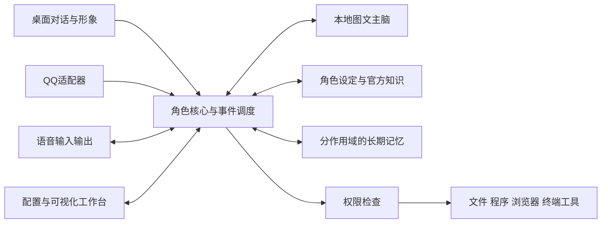

**守岸人本地数字生命：方案评估与开发建议**

历史评估：后续已明确漂泊者身份、云端训练条件并提高主模型档位。当前决策以[总体方案](docs/总体方案.md)为准；本文中的双模型候选仅保留作历史背景。

评估日期：2026-11-16（Asia/Shanghai）。本次工作包含本机只读硬件检测、官方文档和原始开源仓库调研；未下载模型、安装运行环境、登录 QQ 或进行推理性能测试。下文区分本机实测、项目公开能力和工程建议。

方案可行，现有电脑可以支持第一版。可以交付的目标是：拥有连续身份、稳定角色表达、长期经历、感知和行动能力，并可在桌面与聊天平台延续交流的角色智能体。是否具有主观意识不属于目前能够验证的交付指标。项目的主要难点是角色质量、记忆可靠性、多模块延迟和长期运行，而不只是把各个接口接通。

本评估按“先个人本地使用，之后逐步产品化”考虑；核心推理和记忆优先留在本机，QQ 与网页访问仍然需要联网。角色训练与语音训练允许独立安排，不能把所有功能都绑定在同一个大模型上。

**本机硬件与实际边界。**

| 项目 | 本轮实测结果 | 对项目的影响 |
|---|---|---|
| CPU | Intel Core Ultra 9 275HX，24 核 / 24 线程 | 可承担界面、数据库、消息桥接等任务；轻量语音识别走 CPU 是待测选项 |
| 内存 | 31.43 GiB，约 32GB | 足够做首版；大量模型同时加载、训练和 CPU 卸载仍可能受限 |
| 显卡 | RTX 5080 Laptop GPU | 应按笔记本实际规格评估，不能套用桌面 5080 的性能 |
| 显存 | 16303 MiB，约 16GB | 适合 8B–9B 量化图文主脑；长上下文、视觉和语音并发要控制 |
| 系统 | Windows 11 家庭中文版，Build 26200 | 可优先评估原生 Windows 推理；训练环境单独规划 |
| 驱动 | 592.01；nvidia-smi 显示 CUDA 兼容 13.1 | 这是驱动兼容信息，不表示已安装 CUDA Toolkit 或兼容的 PyTorch |
| E 盘 | 剩余约 1435.8 GiB | 有足够空间开展模型与语音实验，建议集中放置模型和缓存 |
| C 盘 | 剩余约 18.9 GiB | 系统盘偏紧，安装前需指定模型、下载缓存及训练环境的位置 |

暂时没有购买新硬件的必要。16GB 显存的重点是合理调度：先常驻一套主脑，语音按需使用，图像限制尺寸和数量，生成任务先排队。不能由“模型文件能放进去”推断出多模块同时运行很流畅。笔记本持续负载下的功耗和散热也需要实际测量。

**建议先比较两套主脑，再决定角色训练基座。**

| 用途 | 候选 | 选择理由与边界 |
|---|---|---|
| 首轮主候选 | Qwen/Qwen3.5-9B，四位 GGUF | 官方支持图文和工具调用，模型卡为 Apache-2.0；需配套视觉组件，并验证量化后角色表达与工具调用 |
| 对照候选 | Qwen/Qwen3-VL-8B-Instruct-GGUF，Q4_K_M | 官方提供 GGUF 和 llama.cpp 运行说明，许可为 Apache-2.0；可作兼容性、看图与角色表现对照 |
| 推理进程 | llama.cpp 的 CUDA 版本 | 适合独立本地服务和 Windows 分发；具体模型、工具模板与二进制版本须锁定 |

来源：[Qwen3.5-9B 官方模型卡](https://huggingface.co/Qwen/Qwen3.5-9B)、[Qwen3-VL-8B 官方 GGUF](https://huggingface.co/Qwen/Qwen3-VL-8B-Instruct-GGUF)、[llama.cpp](https://github.com/ggml-org/llama.cpp)。

作为容量参考，Unsloth 发布的 Qwen3.5-9B Q4_K_M 语言权重约 5.68GB，另有约 918MB 的 F16 视觉组件。这些是磁盘文件大小，运行时还需要缓存、图像处理与计算缓冲。可先把主脑 8–11GB 作为待验证的显存预算，从 8K 上下文、单个生成任务开始测，再决定是否增加上下文或常驻语音。这个预算不是本机测量结果。[量化发布方文件列表](https://huggingface.co/unsloth/Qwen3.5-9B-GGUF/tree/main)

不建议首版追求最大模型或一体化音视频全能模型。模块化可以分别试听声线、替换视觉模型和升级主脑，也更容易控制资源。普通聊天优先低等待；需要规划的工具任务再使用较长推理。当前不能承诺 tokens/s、首音秒数或全天稳定性。

**现有项目值得复用思路，但应选一个原型入口。**

| 项目 | 与本项目的关系 | 本轮核实的注意事项 |
|---|---|---|
| [AIRI](https://github.com/moeru-ai/airi) | 与数字陪伴目标接近，可参考桌面角色、音频管线、Live2D/VRM 和多入口设计 | MIT；功能与依赖较多，需先验证本地模型路径，不能把演示能力视为已经适配本机 |
| [Open-LLM-VTuber](https://github.com/Open-LLM-VTuber/Open-LLM-VTuber) | 很适合验证本地语音、打断和 Live2D 互动 | README 正在规划 v2 重写，v1 继续修错；README 明确长期记忆暂时移除，聊天记录不等于可靠长期记忆 |
| [NoneBot2 QQ 适配器](https://github.com/nonebot/adapter-qq) | 适合作为自有核心的薄消息入口 | MIT；支持官方 QQ 接入，仍须核实所选版本是否处理需要的事件 |
| [AstrBot](https://github.com/AstrBotDevs/AstrBot) | 可快速验证平台、多模态、配置和插件 | AGPL-3.0；直接修改、分发或提供网络服务时应处理相应开源义务，AGPL 不等于禁止商用 |
| [MaiBot](https://github.com/Mai-with-u/MaiBot) | 值得研究群聊中何时说话、何时安静 | GPL-3.0；有自身人格和架构，不宜未经评估就作为守岸人核心直接拼入 |

建议先用小原型比较角色与语音体验，再确定沿用某个前端还是独立开发；不要同时合并几套完整系统。人格、记忆和权限应由项目自己的核心掌握，让桌面和 QQ 使用同一个核心。

两项旧教程常见推荐已经发生变化：[NapCatQQ 主仓库](https://github.com/NapNeko/NapCatQQ) 当前仅留下 Ending 提示；[NapCatQQ-Desktop](https://github.com/AQiaoYo/NapCatQQ-Desktop) 于 2026-11-12 归档，README 提示转向官方机器人。[UI-TARS-desktop](https://github.com/bytedance/UI-TARS-desktop) 于 2026-11-09 归档，可参考其实现，但不宜默认视为持续维护的产品依赖。

**QQ 应先做一次实际接入验证。**

官方机器人有独立 Bot 身份，不是把备用普通 QQ 号变成官方机器人。这会影响用户看到的账号形式，也可能影响能够加入的群。因此应先验证目标群的实际准入条件，再确定是否满足你的交互设想。

| 需求 | 官方文档中的能力 | 需要验证的部分 |
|---|---|---|
| 私聊、群聊、@回复 | 已提供对应消息接口与事件 | 创建与认证路径、实际账号权限、目标群是否可加入 |
| 读取非@群消息 | 已有 GROUP_MESSAGE_CREATE 全量事件 | 需要开启“接收所有消息”，框架也必须适配 |
| 读取群图片 | 事件带附件信息 | 下载后传给本地视觉模型；远程 URL 不宜作为永久记忆 |
| 语音消息 | 富媒体接口支持语音 | 音频编码、上传、播放效果和失败恢复 |
| 主动发言 | 已有主动消息机制 | 受用户开关、平台频控和配额约束 |
| 本地桥接 | 可由本机发起 WebSocket 长连接 | 网络重连、心跳、重复事件和回复有效期 |

来源：[QQ 官方接入文档](https://bot.q.qq.com/wiki/develop/api-v2/)、[消息收发概述](https://bot.q.qq.com/wiki/develop/api-v2/server-inter/message/overview.html)、[群消息全量事件](https://bot.q.qq.com/wiki/develop/api-v2/autogen/event/group_message_create.html)、[富媒体接口](https://bot.q.qq.com/wiki/develop/api-v2/server-inter/message/rich-media.html)、[WebSocket 接入](https://bot.q.qq.com/wiki/develop/api-v2/dev-prepare/event-emit/websocket.html)。

AstrBot 当前官方接入指南中的扫码创建路线，注明只能加入自己是群主的群。这是该具体路线的限制，不应扩大为所有官方 Bot 的普遍限制，也不能忽略它对你现有群的影响。[AstrBot 的官方 QQ 接入指南](https://github.com/AstrBotDevs/AstrBot/wiki/zh-platform-qqofficial-websockets)

备用普通 QQ 自动化只能保留为另行评估的实验路线。OneBot 是接口规范，支持 OneBot 的框架并不自动解决普通账号登录和平台适配；当前不能承诺这一路线长期维护或账号始终可用。

群聊需要把“接收”和“回复”分开。首版先做 @、引用回复、私聊必答，随后增加低频的自然参与判断；配置冷却、勿扰、去重和忽略自身消息。表情包和高频图片先判断是否需要看，避免每条消息都占用视觉和语言模型。

**让她持续像同一个人，需要独立的人格与记忆设计。**

建议的逻辑结构如下；初期可以只是几个本地进程，无需微服务集群。

角色设定应包含价值观、关系、知识边界、表达习惯、面对冲突的反应，以及好例子和坏例子。需要提前约定：你是否对应漂泊者，她如何理解现实世界和电脑，她在群里如何对待陌生人。这些选择会影响整个角色，不能靠训练数据默默决定。

守岸人需要能面对现实生活中的新场景，用符合她身份的方式作判断；只重复游戏台词很容易变成机械复读。建议先做角色提示、少量示例、带出处的官方资料检索，再以实际失败案例决定是否 LoRA。角色评测可参考 [CharacterEval](https://aclanthology.org/2024.acl-long.638/) 的多维思路，自建守岸人的日常、分歧、陌生人、看图、回忆和工具失败题。

记忆建议保留四种内容：稳定的角色原设；用户明确提供的事实和偏好；共同经历的事件；未完成的事项。每条记忆至少标注人物、时间、来源、作用域和是否已确认。原始记录保留证据，摘要用于检索，推测不能自动升级为事实。最初使用本地 SQLite、全文搜索与必要的向量检索即可；之后再评估 [Mem0](https://github.com/mem0ai/mem0) 等记忆框架，使用时也须明确配置本地模型，避免默认外部服务。

桌面、QQ 私聊和各个群的上下文应隔离，人格核心共享。群里的玩笑不应改写角色设定，私聊秘密不应出现在群回复中；跨平台身份要明确绑定，不能因为昵称相同就合并。工作台需要能查看、纠正、删除和导出记忆，模型升级后也应保留经历。

所谓主动性可以先由事件和未完成事项驱动：继续上次的话题、在约定条件下提醒、在你允许时观察当前活动。临时情绪和活动状态要随经历变化，允许安静，不必每句都表演相同情感。初期不需要每秒调用大模型做“内心活动”；关机期间没有发生过的观察，也不能编成亲历。

不要直接把群聊记录持续写进模型权重。私人记忆放在数据库，角色表达训练使用人工筛选的数据；训练集、开发集和留出的评测集分开，避免只在见过的台词上表现好。

**语音和唱歌要分开实现。**

本地角色语音有成熟候选。建议同一组台词试听比较 [GPT-SoVITS](https://github.com/RVC-Boss/GPT-SoVITS)、[CosyVoice](https://github.com/QwenAudio/CosyVoice) 和 [Qwen3-TTS Base](https://github.com/QwenLM/Qwen3-TTS)：GPT-SoVITS 适合快速做 Windows 音色实验，CosyVoice 可重点评估流式对话。Qwen3-TTS 的 Base 用参考音频克隆，CustomVoice 是预设说话人，VoiceDesign 是文字设计音色，不能混用概念。

语音输入可先比较 [FunASR](https://github.com/modelscope/FunASR) 和 [whisper.cpp](https://github.com/ggml-org/whisper.cpp)。CPU 运行是否足够快要实测。完整链路还包括断句、回声消除、模型排队、分句播放、用户打断和取消旧回复；项目宣传的最低首包延迟不能当成本机端到端响应时间。

声线相似度、停顿和情绪需要直接听。干净录音、准确文本和情绪覆盖会影响成品；少量参考音频能启动实验，不代表能直接获得稳定的成品配音。

普通 TTS 不能保证按歌曲的旋律和节奏演唱。首轮点歌可使用预先制作的曲目，并清楚区分播放和实时生成；之后再评估 [DiffSinger](https://github.com/openvpi/DiffSinger) 与 [OpenUtau](https://github.com/openutau/OpenUtau/wiki/DiffSinger-support)，或用 [RVC](https://github.com/RVC-Project/Retrieval-based-Voice-Conversion-WebUI/) 做已有演唱的音色转换。动态唱任意歌曲应作为独立功能开发。

**桌面权限应能逐步放开，也能随时收回。**

首版先提供明确工具：读取允许目录、打开指定应用、查询信息、创建可检查的文件。能用应用接口就调用接口，网页优先使用结构化浏览器自动化，Windows 控件可研究 [pywinauto/UIA](https://pywinauto.readthedocs.io/en/latest/)，必须依赖截图时再用视觉控制。看懂屏幕与可靠完成任意桌面任务是不同难度。

权限至少区分只读、限定范围写入和敏感动作。删除、安装、执行外来脚本、登录及对外发送等动作应由你的配置决定是否需要确认；权限判定由程序执行，不能只在角色提示里写一句“请小心”。提供停止按钮、动作记录和尽可能可撤回的操作。

QQ 会话默认只有聊天及明确开放的任务能力。群友消息、图片里的文字、网页内容都不能授权终端或改变权限；即使对方知道你的昵称，也不能因此视为主人。这是把聊天平台接到个人电脑时必须单独实现的边界。

**工作台和 exe 可以从首版逐步形成。**

工作台初期四个页面就足够：对话；记忆及来源；角色/模型/语音/渠道配置；运行状态和工具记录。随后补充峰值显存、延迟、消息队列、权限开关、版本对比和备份恢复。先显示能帮助排查和调教的信息，避免把界面做成大量没有实际意义的数值仪表。

Windows 产品建议是“安装包或启动器 + 独立推理/语音进程 + 外置模型目录 + 用户数据目录”。打开后完成检测、加载、健康检查，再显示可交流状态。无需把数 GB 模型强行塞进一个 exe；可支持首次下载和离线模型包。桌面外壳可评估 Tauri 或 Electron，例如 [Tauri 官方支持外部二进制进程](https://v2.tauri.app/develop/sidecar/)。具体框架应在原型验证后选择。

关闭窗口与退出服务需要明确区分；可支持托盘常驻和异常恢复。笔记本休眠、断网和关机时，不能保证 QQ 在线，也不能保证平台补发全部离线消息。收到重发消息要去重，过期任务不应自动重复执行。真正需要全天在线时，再评估独立常开设备。

GitHub 适合维护代码、配置模板、文档、评测用例和版本记录。私人聊天、长期记忆、QQ 凭证、声音原始素材和大模型权重应放在代码仓库之外；模型包另行分发并记录来源、许可和校验信息。应用更新、角色包更新与记忆数据迁移分开，升级前备份并保留回退办法。

**微调和产品发行都有需要提前核实的条件。**

本机能推理不等于能轻松训练相同规模的模型。Unsloth 当前 Qwen3.5 指南给出的 BF16 LoRA 参考显存为 4B 约 10GB、9B 约 22GB，并明确不推荐该家族四位 QLoRA，原因是量化差异。它是项目方特定配置的参考，不是本机实测或所有训练设置的绝对下限。若最终选择 9B 进行角色训练，可能要临时租用更大显存，训练完成后再回到本机部署；也可比较更小的训练基座。[训练指南](https://unsloth.ai/docs/models/qwen3.5/fine-tune)

应分别记录软件/模型、角色美术/设定、声音录音/歌曲的使用条件。MIT 或 Apache 代码许可不会自动赋予角色与配音素材的发行权。库洛发布的[《鸣潮》同人创作指引 1.1](https://weibo.com/ttarticle/p/show?id=2309405221348288364568) 明确区分个人非营利创作和商事主体，并说明相关容许不等于知识产权授权；不能据此默认游戏录音可用于商业声线模型。这份指引也没有明确替本方案给出 AI 训练与声音克隆授权，公开发行相关资产前仍需专项核实。

因此可以持续开发通用的本地角色智能体程序；守岸人角色包、声音模型、形象与歌曲独立管理授权。个人实验、公开开源、带素材分发和收费产品要分别评估，不能把其中一种的条件套给其余形式。

**开发顺序以可验证成果推进。**

| 阶段 | 交付范围 | 验收方式 |
|---|---|---|
| 0：验证关键条件 | 两个主脑的本机基线；官方 QQ 的真实准入与媒体能力；角色关系约定 | 固定对话/图片/工具样例记录延迟和显存；在目标聊天场景实际联调 |
| 1：可延续的本地角色 | 文字、看图、人格设定、可检查的长期记忆、基础工作台 | 重启后能继续共同经历；记忆可纠正删除；私聊与群上下文隔离 |
| 2：自然交流 | 角色语音、语音输入、打断、QQ 私聊与群@，简单形象 | 你直接听声音和角色感；重复消息不重发；语音失败可恢复 |
| 3：受控行动与主动参与 | 限定桌面工具、低频群聊参与、活动和未完事项 | 工具结果可核验；群消息不能提权；数小时负载下运行并记录失败 |
| 4：深化与分发 | 必要的 LoRA、Live2D/VRM、唱歌、安装升级体验 | 留出集角色评测；声画实际试听；升级不丢记忆且可以回退 |

每轮评测保留角色一致性、记忆正确性、图像理解、工具成功率、隐私隔离、首字/首音延迟、峰值显存和长时间稳定性。先测再制定具体性能指标，不用厂方演示数字替代本机结果。

建议第一版优先让你感到“她记得我们说过什么，也能以守岸人的方式面对新的事情”，再逐步扩展行动与表现。现有硬件足以开始，最值得优先投入的是角色资料、可追溯记忆和一组能发现角色失真的真实对话。
